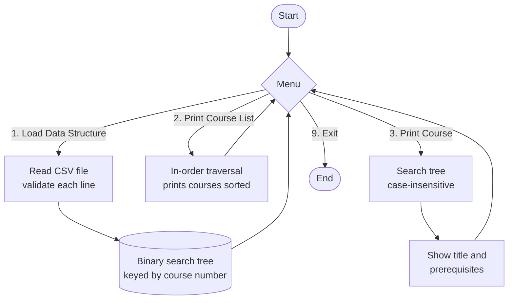

# ABCU Course Planner: Data Structures and Algorithms (CS 300)

A C++ command-line tool that helps ABCU's Computer Science advisors plan student schedules. It loads the course catalog from a CSV file into a **binary search tree**, prints every course in alphanumeric order, and looks up any course with its prerequisites.

Built for **CS 300: Data Structures and Algorithms** at Southern New Hampshire University.

---

## How It Works



## Choosing the Data Structure

In Project One I wrote pseudocode for three data structures and compared their runtimes (average case):

| Data structure | Find one course | Print all courses in order | Verdict |
|---|---|---|---|
| Vector | O(n) | O(n log n), must sort first | Slow at both |
| Hash table | O(1) | O(n log n), no built-in order | Fast lookup, but has to sort every time |
| **Binary search tree** | **O(log n)** | **O(n), in-order traversal** | **Chosen: does both jobs well** |

---

## Repository Contents

| File | Description |
|---|---|
| `Project-One-Data-Structure-Analysis.docx` | Pseudocode and runtime/memory analysis of a vector, hash table, and binary search tree |
| `CoursePlanner.cpp` | Final C++ program (Project Two) |
| `sample_courses.csv` | Small sample catalog for trying the program |

## Build and Run

```bash
g++ -std=c++17 -o course_planner CoursePlanner.cpp
./course_planner
```

Choose option **1** and enter `sample_courses.csv`, then try options **2** and **3**.

**Input format:** one course per line, `CourseNumber,Course Title,Prerequisite1,Prerequisite2,...`

```
CSCI300,Introduction to Algorithms,CSCI200,MATH201
```

**Features**
- Case-insensitive search (`csci300` works the same as `CSCI300`)
- Skips blank lines and extra commas from files saved in Excel
- Warns about prerequisites that aren't in the catalog
- Asks for the file name instead of hard-coding it

## Skills Demonstrated

C++ · binary search trees · Big O analysis · file I/O and input validation · pseudocode and algorithm design

---

## Reflection

**What was the problem you were solving in the projects for this course?**
The academic advisors at ABCU needed a program to help them when they talk with students. They wanted to load the Computer Science course list from a file, print all the courses in alphanumeric order, and look up one course to see its title and prerequisites. In Project One I designed the program and compared data structures. In Project Two I wrote the actual code in C++.

**How did you approach the problem? Consider why data structures are important to understand.**
I started by writing pseudocode for three data structures: a vector, a hash table, and a binary search tree. Then I worked out the Big O runtime for each one. The hash table was fastest for looking up one course, but it has no order, so I would have to sort it every time the advisors wanted the full list. The vector was slow at both. I picked the binary search tree because it does both jobs well. Searching is fast, and an in-order traversal prints the courses already sorted. This showed me why data structures matter. The same program can be fast or slow depending on how the data is stored, and the right choice depends on what the user actually needs to do.

**How did you overcome any roadblocks you encountered while going through the activities or project?**
My biggest roadblock was not in the code. My program would not compile in the Git Bash terminal in VS Code. g++ quit with no error message, which was confusing because the same code worked in PowerShell. I tested it step by step and found that Git Bash was causing the compiler to load the wrong support files. Putting the compiler folder first in my PATH fixed it. I had this same problem in earlier classes and never knew why, so I was happy to finally solve it. I also learned that a CSV saved from Excel can include hidden characters and extra commas, so I made my file reader skip them.

**How has your work on this project expanded your approach to designing software and developing programs?**
Before this course, I usually started coding right away. This time I planned first with pseudocode and runtime analysis, and the coding went much smoother because I already knew how each part would work. I also started thinking about how the user will use the program, like letting them type "csci400" in lowercase and showing a clear message when they pick an option that does not exist.

**How has your work on this project evolved the way you write programs that are maintainable, readable, and adaptable?**
I tried to keep each function doing one job, like loading the file, searching the tree, or printing a course. That makes the code easier to read and easier to fix later. I used clear variable names and short comments so someone else, or me in the future, can understand it quickly. The program also asks for the file name instead of hard-coding it, so it can work with a different course file if the department adds new courses.
